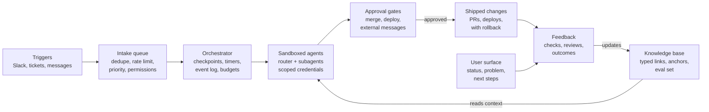
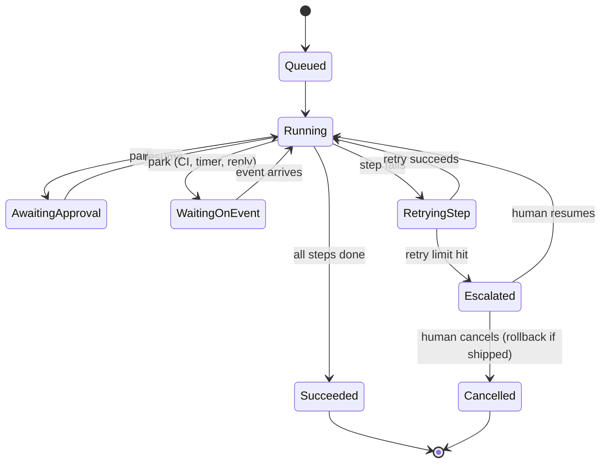

# Hands-Off Software Factory — Spec

Oct 28, 2026 · Dharanish Kedarisetti

## Summary

The factory turns tickets, threads and messages into shipped changes without a human driving each step. Humans approve irreversible actions and give feedback; agents do the rest. Every run makes the next run cheaper: knowledge and hindsight compound, so cost per task should fall each month.

**Goals**

- Runs survive crashes, deploys and multi-day waits, and resume from the last checkpoint.
- No action with real-world side effects runs twice.
- Every agent works inside a sandbox with scoped, short-lived credentials.
- Tool calls and tokens per successful task fall over time.
- A user can understand a run's state in under 30 seconds and give feedback on any part of it.

**Non-goals**

- Fully autonomous production deploys. Deploys stay behind a human gate.
- Bit-exact regeneration of model output. Replay reads from the event log instead.
- Autonomous adoption of new tools or models found online. A human approves each one.

## Architecture

Work runs along the top row and down through the gates; feedback and knowledge close the loop, so each run starts with more context than the last.

## Run lifecycle

Approval and event waits park the run with no compute held. A failed step retries alone; when retries hit the limit, or an escalation criterion fires, the run goes to a human, who resumes or cancels it.

## Requirements

Each requirement has an ID so tests, tickets and feedback can point at it. "Must" items block launch; "should" items do not.

### Durable execution

- **DUR-1 (must):** Checkpoint after every step. A run resumes from its last completed step after any crash or deploy.
- **DUR-2 (must):** Record every model response and tool result in an append-only event log. Replay reads from the log; it never calls the model again.
- **DUR-3 (must):** Every side effect carries an idempotency key derived from run ID + step ID. A retried step that already succeeded is a no-op.
- **DUR-4 (must):** Retry only the failed step, with a per-step limit and backoff.
- **DUR-5 (must):** Long waits (approval, CI, external reply) park the run on a durable timer or event. A parked run holds no compute.
- **DUR-6 (must):** Workflow definitions are versioned. In-flight runs finish on the version they started with.
- **DUR-7 (should):** Agents share state through a versioned store with explicit writes, not a shared mutable object.

### Sandbox and execution

- **SBX-1 (must):** Each run gets an isolated filesystem and an egress allowlist.
- **SBX-2 (must):** Credentials are short-lived, scoped to the task, and injected at the tool layer. They never enter model context.
- **SBX-3 (must):** Content from tickets, Slack, email and the web is treated as data. Instructions inside it are not executed.
- **SBX-4 (must):** Runs are headless, with per-step traces, a token and cost budget, a wall-clock timeout, and a kill switch.

### Knowledge

- **KNO-1 (must):** Every entry records source, author (agent or human), timestamp and run ID.
- **KNO-2 (must):** Code references pin repo, path, line range and commit SHA. A nightly job checks that each anchor still resolves and flags those that do not.
- **KNO-3 (should):** Entries carry tags and typed links: `depends-on`, `supersedes`, `contradicts`, `derived-from`.
- **KNO-4 (should):** Entries have a TTL or a revalidation trigger. Expired entries are not used for routing.

### Knowledge retrieval

- **RET-1 (must):** Retrieval uses BM25 over knowledge entries and session learnings. Indexed fields: body, tags, anchor paths and link targets; tags get a higher field weight.
- **RET-2 (must):** Expired entries (KNO-4) and entries with broken anchors (KNO-2) are filtered out before ranking.
- **RET-3 (must):** Each subagent queries with its task-class filter and a per-class top-k, so it gets only the context its class needs (ENT-3).
- **RET-4 (must):** Every retrieval is logged as an event (query, returned entry IDs, scores). Replay sees the same context, and feedback can name the entry that helped or misled.
- **RET-5 (should):** The index updates on every knowledge write and rebuilds nightly with the anchor check.
- **RET-6 (should):** Retrieval quality is measured on the golden set as recall@k of entries a human marked relevant. BM25 parameters (k1, b) are tuned against it.

### Session learnings

- **LRN-1 (must):** At the end of each run, the agent writes a learning record: what worked, what failed, dead ends, and the shortest path found. It links to the run and its steps.
- **LRN-2 (must):** Learnings are knowledge entries of type `learning`, indexed by BM25 with the rest, so the next run in the same task class retrieves them.
- **LRN-3 (must):** Learnings accumulate per agent and per task class. The same finding across runs merges into one entry with a count and links to every source run.
- **LRN-4 (must):** A learning from a failed or reverted run is marked as such. A later contradicting outcome adds a `contradicts` link and expires it (ENT-4).
- **LRN-5 (should):** A weekly review promotes frequently retrieved learnings into subagent prompts or tools, and drops learnings never retrieved.

### Knowledge interfaces

Knowledge is pluggable: Pi, Claude Code, Codex and the factory's own agents all read and write the same store, so what one agent learns compounds for every other.

- **KIF-1 (must):** Knowledge is a standalone component. It runs without the orchestrator, and any agent harness can use it.
- **KIF-2 (must):** The source of truth is plain files: one Markdown file per entry, with YAML frontmatter for tags, typed links, anchors, source, author, run ID and expiry. The BM25 index and metadata database are caches, rebuilt from the files.
- **KIF-3 (must):** One core library with three front doors: a CLI (`sf-kb`) with JSON output, an MCP server, and a Rust crate. All three expose the same operations and behave identically.
- **KIF-4 (must):** The contract has six operations: `search(query, task_class, top_k)`, `get(id)`, `add(entry)`, `learn(run, record)`, `feedback(id, verdict, note)` and `check_anchors()`.
- **KIF-5 (must):** Every call records the calling agent (for example `pi`, `claude-code`, `factory`) and its run or session ID, so retrieval and learnings can be compared across agents (RET-4).
- **KIF-6 (should):** Adapters stay thin and hold no logic: a Pi extension that wraps the CLI, and MCP configuration for MCP-capable agents.
- **KIF-7 (should):** Concurrent writers are safe. Writes are atomic file renames plus an index lock, so several agents can learn at once.
- **KIF-8 (should):** The contract is versioned. A breaking change bumps the version, and older clients get a clear error instead of wrong results.

### Triggers and intake

- **TRG-1 (must):** Connectors (Slack, tickets, messages) write to a work queue. The queue is separate from the knowledge base.
- **TRG-2 (must):** Intake deduplicates, rate-limits and assigns priority.
- **TRG-3 (must):** A trigger permission table states which source may start which workflow. No chat message can start a deploy.
- **TRG-4 (should):** Recurring bottlenecks found in intake become backlog items with links to their evidence.

### Feedback

- **FBK-1 (must):** Feedback comes from three sources: automated checks (tests, evals, linters), human review, and outcomes (survived, reverted, caused an incident).
- **FBK-2 (must):** Each feedback record is structured and anchored to a step, an artifact span or a knowledge entry.
- **FBK-3 (must):** Feedback updates the knowledge base and the eval set within one day.

### Entropy control

- **ENT-1 (must):** A golden task set runs on every change to a prompt, tool, model or workflow. A regression blocks the change.
- **ENT-2 (should):** A router picks the cheapest model that passes the evals for that task class.
- **ENT-3 (should):** Subagents get bespoke context: only the tools and knowledge their task class needs.
- **ENT-4 (should):** Learned shortcuts from past runs carry a TTL and are dropped when a related run fails.
- **ENT-5 (should):** A weekly scheduled review proposes removals: unused tools, idle subagents, redundant steps. A human approves each removal.

**Code maintainability** (code the factory writes must not rot as runs accumulate):

- **ENT-6 (must):** Every PR the factory opens reports deltas against its base: Maintainability Index per changed module, cyclomatic and cognitive complexity per function, duplication, and call-graph metrics (fan-in, fan-out, call depth, cycles, coupling between modules). Tools: rust-code-analysis for Rust, radon for Python.
- **ENT-7 (must):** A ratchet blocks merge when a PR lowers a module's Maintainability Index, adds a call-graph cycle, or pushes a function past its complexity threshold. The run escalates instead of merging. Thresholds are set per repo from a baseline.
- **ENT-8 (must):** Best practices are enforced as checks, not only as prompts: linters (clippy, ruff), dead-code detection, layering rules on the call graph, and a conventions file that agents retrieve.
- **ENT-9 (should):** A weekly job ranks hotspots (falling Maintainability Index, high complexity and high fan-in, weighted by churn) and opens small refactor PRs through the normal gates.
- **ENT-10 (should):** When a task class's PRs repeatedly lower maintainability, that pattern becomes a session learning (LRN-1) and a golden-set case.

### User surface

- **UX-1 (must):** Every run page opens with one status line, then the problem, then the next steps. Detail expands on demand.
- **UX-2 (must):** Status and instructions use ASD-STE100 rules. Narrative explanation uses plain English.
- **UX-3 (must):** A user can select any element on the page and attach feedback to it in one action.
- **UX-4 (should):** A reviewer can step through a run's events with the keyboard, without opening raw logs.
- **UX-5 (must):** The run page is a versioned template. Each change to it is rendered against a fixed set of sample runs and reviewed before release, like a prompt change (ENT-1).
- **UX-6 (must):** The page logs usage signals: time to first action, sections expanded, feedback per page, and runs where the user opened raw logs. Opening raw logs counts as a surface miss.
- **UX-7 (must):** Feedback about the page itself (unclear, too long, missing detail) is a feedback record (FBK-2) that targets the template section, and feeds the next template revision.
- **UX-8 (should):** A monthly review turns the top surface misses into template changes and checks that each change moved its metric. Changes that did not are reverted.
- **UX-9 (should):** Wording that users repeatedly rewrite or ask about becomes a glossary entry in the knowledge base.
- **UX-10 (should):** A scheduled scan checks online sources (design systems, agent-UI patterns, review and annotation tools) for new approaches. Each candidate becomes a backlog item with its source link, is trialled as a template variant against the sample runs and usage metrics, and ships only with human approval (as ENT-5).

## Data model

Five records carry the system. The event log is the source of truth; run and step state can be rebuilt from it.

| Record | Key fields | Written by | Notes |
| --- | --- | --- | --- |
| Run | run_id, workflow_id, workflow_version, trigger_ref, state, budget_tokens, budget_usd, created_at | Orchestrator | One per work item. `state` follows the run lifecycle. |
| Step | step_id, run_id, agent_id, model_id, attempt, status, idempotency_key, checkpoint_ref | Orchestrator | `idempotency_key` = hash(run_id, step_id). |
| Event | event_id, run_id, step_id, seq, type, payload_ref, ts | Orchestrator, tools | Append-only. Types: model_response, tool_call, tool_result, approval, feedback, error. |
| Knowledge entry | entry_id, body, tags, links[{type, target}], anchors[{repo, path, lines, sha}], source, author, run_id, expires_at | Agents, humans | Anchors revalidated nightly (KNO-2). |
| Feedback | feedback_id, target{kind, id, span}, source{auto, human, outcome}, verdict, note, author, ts | Checks, users, outcome monitors | Feeds the knowledge base and the eval set (FBK-3). |

Work items live in a separate queue table (item_id, source, dedupe_key, priority, status, run_id) so "what needs doing" never mixes with "what we know".

## Safety and governance

Hands-off means no human drives the work, not that no human can stop it. These controls decide when the factory pauses.

**Approval gates** (run parks in `awaiting_approval` until a human answers):

| Action | Gate |
| --- | --- |
| Merge to a protected branch | Human approval |
| Production deploy | Human approval |
| Message to anyone outside the team | Human approval |
| Spend above the run budget | Human approval |
| New tool, model or connector | Human approval via weekly review (ENT-5) |
| Draft PR, branch, comment on own ticket | None |

**Escalation criteria** (run stops and asks a human):

- Golden-set eval fails for the change.
- Agent confidence or self-check falls below the task-class threshold.
- Step retries hit the limit.
- Input contains instructions that conflict with the task (possible injection).

**Audit, rollback, cost**

- Every action records the run, step, agent and the approval that allowed it. The audit log is append-only.
- Every shipped change has a tested rollback path: a revert PR or a feature flag.
- Budgets apply per run and per day across all runs. Crossing the daily budget pauses intake, not running work.

## Success metrics

The headline metric is cost per successful task, tracked monthly: if the loops work, it compounds downward. Targets below are proposed starting points, to be set from a baseline in milestone 1.

| Metric | Direction | Proposed target |
| --- | --- | --- |
| Tokens per successful task | Down | -10% month over month for the first 6 months |
| Tool calls per successful task | Down | -10% month over month |
| Task success rate (passes checks, approved, not reverted in 14 days) | Up | Set from baseline |
| Duplicate side effects | Zero | 0 |
| Runs lost to crash or deploy | Zero | 0 |
| Human escalations per 100 runs | Down | Set from baseline |
| Time for a user to state a run's status | Down | Under 30 s in usability tests |
| Stale knowledge anchors | Down | Under 5% of anchors |
| Repo Maintainability Index | Flat or up | No net drop over any quarter |
| Call-graph cycles between modules | Down | No new cycles |

## Milestones

Each milestone ships only when its exit criteria pass. Dates are not set yet.

1. **Knowledge service.** KIF-1 to KIF-8, KNO-1 to KNO-4, RET-1 to RET-6, LRN-1 to LRN-4. Exit: Pi (through its extension) and one MCP agent (Claude Code) both search and write learnings to the same store; every call is logged with its agent; the anchor check runs. Useful on its own before the orchestrator exists.
2. **Durable core.** DUR-1 to DUR-6, SBX-4. Exit: a run survives a forced crash and a deploy mid-run; a retried step creates no duplicate side effect; cost baseline recorded.
3. **Safe execution.** SBX-1 to SBX-3, approval gates, audit log. Exit: an injection test suite passes; every gated action parks and resumes on approval.
4. **Verification loop.** FBK-1 to FBK-3, ENT-1. Exit: golden set runs in CI and blocks a seeded regression.
5. **Intake.** TRG-1 to TRG-4. Exit: Slack and ticket connectors feed the queue with dedupe and the permission table enforced.
6. **User surface.** UX-1 to UX-4. Exit: usability test meets the 30-second status target.
7. **Entropy control.** ENT-2 to ENT-10, LRN-5. Exit: router live; maintainability ratchet blocks a seeded regression; first weekly removal review held.

## Open questions

- [ ] Orchestration engine. Decision for now: local, no server. The Rust core embeds the durable log in a local SQLite file (WAL mode, synchronous=FULL so the last commit survives power loss). Parked runs are rows with a wake time or an awaited event; on start, the process reloads them and resumes. Approvals and webhooks arrive through a local CLI or HTTP endpoint. Python or TS for agent and prompt glue; BM25 index via Tantivy. Port Pi Durable's ideas (per-tool replay policy, requestId admission, owned subagents). Revisit Restate, DBOS or Temporal when runs need more than one machine, or events must land while the machine is off.
- [ ] Event log lives in the local SQLite file. Open: how long is it retained, and how is it backed up?
- [ ] Who owns approvals for each gate, and what is the response-time expectation?
- [ ] What is the first workflow class to run end to end?
- [ ] How is "about 80% ASD-STE100" measured?
